# PRINCESS CASTLE — Phase 1–6 (Godot 4.6)

เกมมือถือ 2D: ปราสาทของเจ้าหญิง 5 คน + การต่อสู้ผลัดเทิร์น + Loot & Equipment + การ์ด
Godot **4.6.2** · GDScript · Renderer: Compatibility (รองรับ Android เครื่องเก่าได้กว้าง) · ไม่มี plugin/asset เสียเงิน

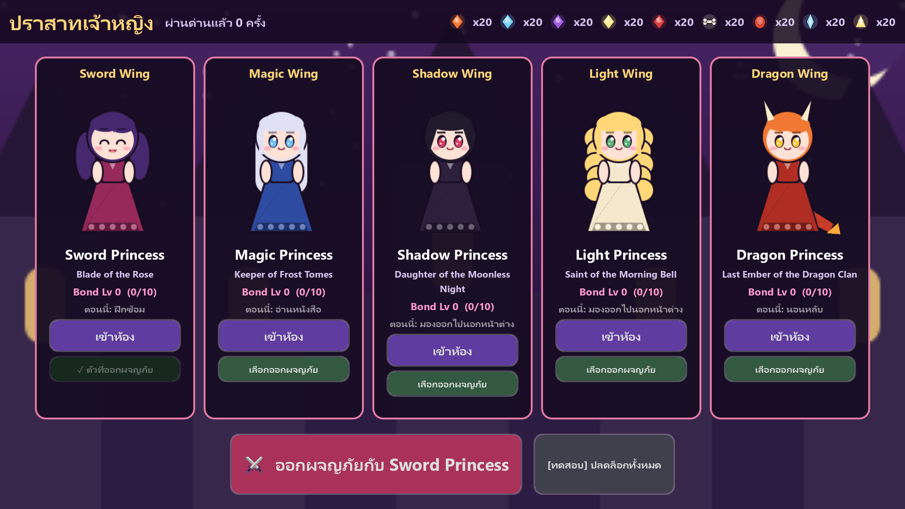

> 🎮 **เล่นบนเว็บ:** https://phuketradar-cloud.github.io/princess-castle/ · **ดาวน์โหลด Windows/Android:** [Releases](https://github.com/phuketradar-cloud/princess-castle/releases)
>
> **เปิดเกม (F5) จะเริ่มที่ปราสาท** → เลือกเจ้าหญิง → ออกผจญภัย → ชนะ/แพ้ → ปุ่ม **ปราสาท** เพื่อกลับ

---

## Phase 6: Mobile Release Preparation (ใหม่)

> **APK พร้อมติดตั้ง:** `build/PrincessCastle-debug.apk` (58 MB, Android 7.0+, ARM64 + ARMv7) — สร้างและตรวจลายเซ็นแล้วบนเครื่องนี้ · **ยังไม่ได้ลองบนมือถือจริง** (ไม่มีเครื่องต่ออยู่)

| ระบบ | ทำงานอย่างไร |
|---|---|
| **Android UI** | แนวนอน (หมุนตามเซนเซอร์) · **Safe Area**: ย่อ UI ให้พ้นรอยบาก/ขอบโค้ง (เฉพาะมือถือ) · **ปุ่ม Back ของ Android**: ปิดหน้าต่างบนสุดก่อน (ตั้งค่า → อุปกรณ์/การ์ด → แผงห้อง → กลับภาพรวม) · ที่หน้าปราสาทกด Back 2 ครั้งเพื่อออก (บันทึกอัตโนมัติ) · ระหว่างต่อสู้ Back ไม่ทิ้งการต่อสู้ · ปุ่มทั้งหมด ≥ 70 px ที่ 1080p |
| **Save/Load** | เซฟ v5: `{version, saved_at, checksum, data}` · เขียน `.tmp` → **อ่านกลับตรวจสอบ** → เก็บเซฟเก่า 2 รุ่น (`.1`, `.2`) → rename · โหลด: ไฟล์หลักเสีย/ถูกแก้ (checksum ไม่ตรง) → ใช้ `.1` → `.2` อัตโนมัติ และเก็บไฟล์เสียไว้เป็น `.bak` · **บันทึกอัตโนมัติ** เมื่อแอปถูกพับ/สลับแอป/ปิด · ปุ่ม "บันทึกเกมตอนนี้" · **เริ่มเกมใหม่** (ยืนยันก่อน, เซฟเดิมเก็บเป็น `.1`) · เซฟ v2–v4 เก่าโหลดได้ · บันทึกครบตามสเปก: ความคืบหน้า, ปลดล็อก, เลเวล, EXP, อุปกรณ์, คลัง, การ์ด, เด็ค, วัตถุดิบ, เฟอร์นิเจอร์, ปราสาท, Bond |
| **Audio** | Autoload `Audio` + `data/sound_bank.tres` (เปลี่ยนเป็นไฟล์เสียงจริงได้ใน Inspector) · เอฟเฟกต์ 17 แบบ (ตี, คริ, หลบ, ฮีล, โล่, สถานะ, ตาย, การ์ด, ชนะ, แพ้, เลเวลอัป, เฟสบอส, เรียกลูกน้อง, รางวัล, เหรียญ, ปลดล็อก, คลิก) + เพลงวน 3 เพลง (ปราสาท / ต่อสู้ / บอส) cross-fade · **สร้างด้วยโค้ด** (`tools/generate_audio.gd`) ไม่มีลิขสิทธิ์ · ทุกปุ่มมีเสียงคลิกอัตโนมัติ |
| **Settings** | ⚙ ในหน้าปราสาทและสนามรบ: ระดับเสียงเพลง / เอฟเฟกต์, **ความเร็วการต่อสู้ 1x/1.5x/2x**, การสั่น (คริ/เฟสบอส), **30/60 FPS** (ประหยัดแบต) · เก็บแยกใน `user://settings.cfg` (เซฟเสียหรือเริ่มเกมใหม่ ค่าตั้งไม่หาย) |
| **Performance** | วัดจริง (`tests/perf_probe.gd`, ปิด vsync): ทุกฉาก **~1 ms/เฟรม**, draw calls ≤ 96, หน่วยความจำ ~67 MB → เหลือเผื่อมากสำหรับ 60 FPS บนมือถือ · จำกัด FPS (ค่าเริ่ม 60) · เปิดบีบอัดภาพ **ETC2/ASTC** สำหรับมือถือ |
| **APK Build** | `export_presets.cfg` (Android, `com.princesscastle.game`, v0.6.0, ไม่รวม tests/tools/docs, สิทธิ์แค่ VIBRATE, immersive) |

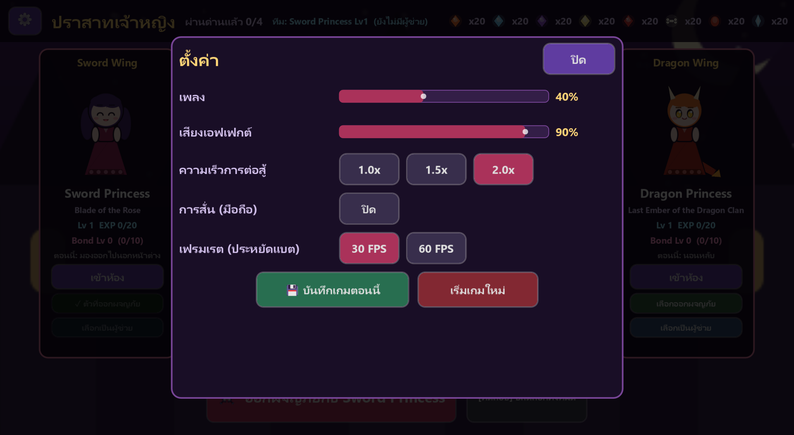
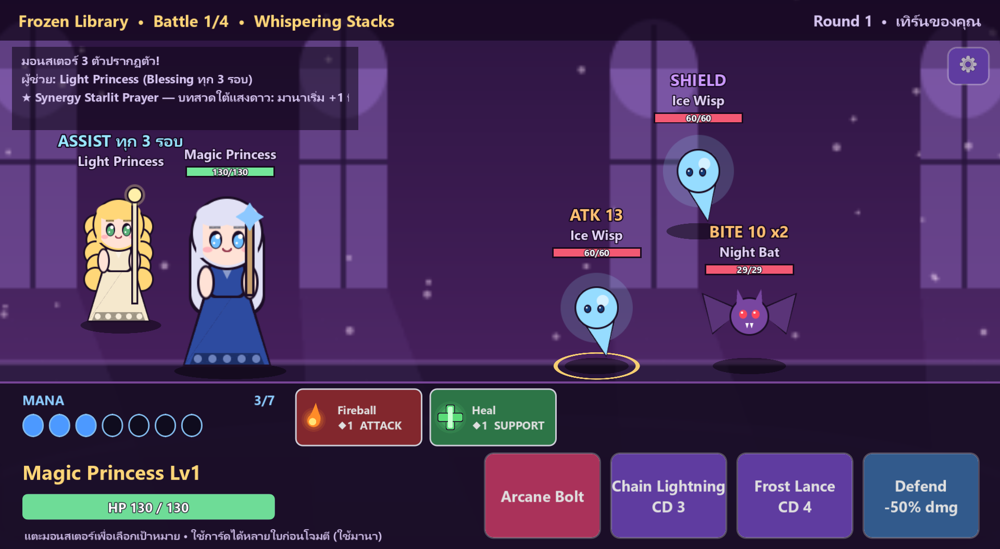

**ไฟล์ใหม่ Phase 6:** `scripts/core/game_settings.gd` (Autoload Settings), `scripts/audio/audio_manager.gd` (Autoload Audio), `scripts/audio/sound_bank.gd`, `scripts/ui/settings_screen.gd`, `scripts/ui/safe_area.gd`, `tools/audio_synth.gd`, `tools/generate_audio.gd`, `assets/audio/*.res`, `data/sound_bank.tres`, `export_presets.cfg`, `tests/test_release.gd`, `tests/perf_probe.gd` · แก้: `game_state.gd` (เซฟ v5), `battle_controller.gd` / `castle_controller.gd` (เสียง, ⚙, Back, Safe Area), `project.godot`

---

## Phase 5: Progression, Bosses & Companion

| ระบบ | ทำงานอย่างไร |
|---|---|
| **4 ด่าน + เลือกด่าน** | Haunted Gate (Lv1) → **Frozen Library** (Lv6) → **Shadow Woods** (Lv10) → **Dragon's Peak** (Lv14) · ด่านถัดไปเปิดเมื่อผ่านด่านก่อนหน้า · หน้าเลือกด่านแสดง ล็อก/ผ่านแล้ว, เลเวลแนะนำ (สีแดงถ้าเลเวลยังไม่ถึง), ชื่อบอส |
| **มอนสเตอร์ใหม่ 9 ตัว** | Ice Wisp (กางโล่ตัวเอง), Imp (ไฟเผา, มาเป็นฝูง), Wyvern (พิษ) + มินิบอส **Frost Golem / Werewolf / Fire Drake** + บอส **Lich Queen / Night Witch / Elder Wyrm** |
| **กลไกบอส (Boss Phases)** | เมื่อ HP ลดถึงเกณฑ์ บอสเปลี่ยนเฟส **ครั้งเดียว**: คลั่ง (ATK เพิ่ม), ล้างสถานะ, กางโล่, ฟื้น HP, **เรียกลูกน้อง** (ลูกน้องมีเจตนาแสดงทันที) — มีข้อความประกาศ + "PHASE!" + เจ้าหญิงตอบสนอง · Lich Queen เรียก Wisp ที่ 70% คลั่งที่ 35% · Night Witch โล่+เรียก Imp ที่ 66%, ล้าง+ฟื้น+เรียกที่ 33% · Elder Wyrm ส่งสัญญาณ **INFERNO** ก่อนพ่นไฟ, เรียก Wyvern ที่ 60%, คลั่งที่ 30% |
| **บอสต้านการควบคุม** | มินิบอส/บอสต้าน Stun/Freeze 60–75% (ติดแล้วเหลือครึ่งเวลา) และ **Banish ไม่ได้เลย** |
| **ความยาก** | เพิ่มด้วย **จำนวน + ความสามารถ + เฟสบอส** (Wisp โล่ต้องตีแรง, ฝูง Imp ติดไฟ, Shaman ฮีล) และสเกลต่อด่าน (`monster_hp_scale/attack_scale`) |
| **เลเวล / EXP** | ทุกมอนสเตอร์ให้ EXP (บอส ×3, ตามสเกลด่าน) หลังชนะแต่ละการต่อสู้ · `20 × Lv^1.5` ต่อเลเวล สูงสุด Lv30 · เจ้าหญิงแต่ละคนมีอัตราโตต่างกัน (Light HP โตสุด, Magic ATK โตสุด, Shadow คริ/หลบโต) · แสดง Lv/EXP ในปราสาท หน้าสถานะ และ HUD · "LEVEL UP!" + บทพูด |
| **ปลดล็อกเจ้าหญิงตามด่าน** | Magic = ผ่าน Haunted Gate · Shadow + Light = ผ่าน Frozen Library · Dragon = ผ่าน Shadow Woods |
| **Companion (ผู้ช่วย 1 คน)** | ปุ่ม "เลือกเป็นผู้ช่วย" ในปราสาท · ยืนแถวหลัง ไม่ถูกโจมตี · ใช้ **ท่าช่วยเฉพาะตัวอัตโนมัติทุก 3 รอบ**: Sword = Cross Slash (ลดพลังโจมตี), Magic = Frost Nova (ทั้งแถว + 30% แช่แข็ง), Shadow = Shadow Mark (ประหารตัวที่ HP ≤20%), Light = Blessing (ฮีลเจ้าหญิง), Dragon = Ember Breath (ทั้งแถว + ไฟเผา) · ได้ EXP 50% + Bond +1 ต่อชัยชนะ |
| **Synergy (ครบ 10 คู่)** | ไม่ใช่แค่ +ATK: **Sword+Magic** ดาเมจ +15% · **Sword+Light** ฟื้น HP 4%/เทิร์น · **Shadow+Dragon** คริ +12% · Magic+Shadow / Magic+Light มานาเริ่ม +1 · Shadow+Light หลบ + ฟื้น · Light+Dragon HP +40 + ฟื้น · ฯลฯ — แสดงในปราสาท หน้าเลือกด่าน และ log การต่อสู้ |
| **บันทึก** | เซฟเวอร์ชัน 4: เลเวล/EXP, ด่านที่ผ่าน, ผู้ช่วย, ด่านที่เลือก · เซฟเก่า (v3) โหลดได้ — จำนวนครั้งที่ผ่านด่านเดิมนับเป็นผ่าน Haunted Gate |

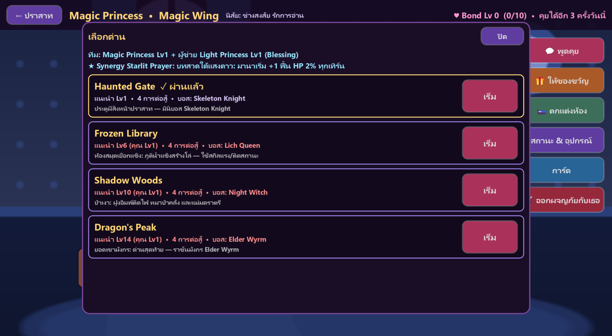
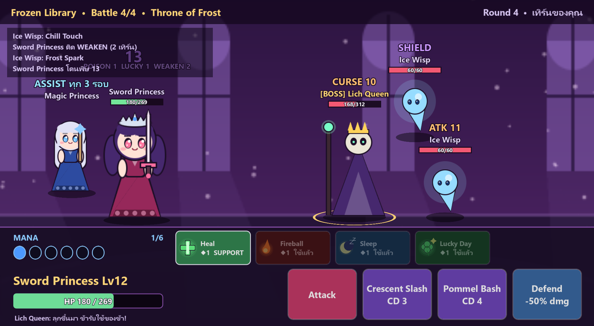
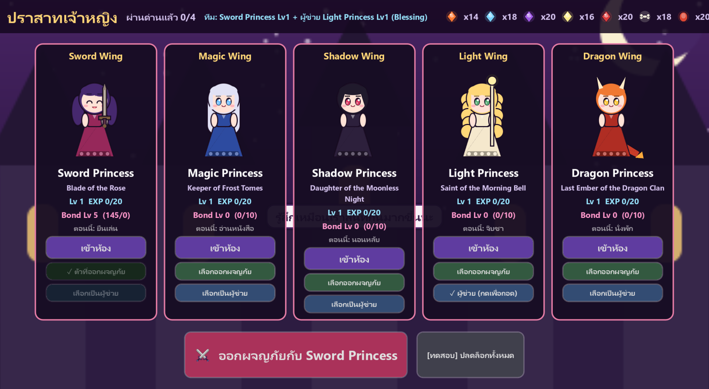

**ความสมดุลของแคมเปญ** (จำลองผู้เล่น 40 คนเล่นต่อเนื่อง ด่าน 1→4 เก็บของ/เลเวล/ผู้ช่วย ด้วยกฎจริง):

| ด่าน | ผ่าน | เฉลี่ยกี่ครั้ง | ผ่านครั้งแรก | เลเวลตอนผ่าน (แนะนำ) |
|---|---|---|---|---|
| Haunted Gate | 100% | 1.1 | 90% | 4.1 (1) |
| Frozen Library | 100% | 2.3 | 20% | 7.3 (6) |
| Shadow Woods | 100% | 2.5 | 23% | 10.7 (10) |
| Dragon's Peak | 100% | 2.9 | 23% | 14.0 (14) |

ท้าทายตั้งแต่ด่าน 2 แต่ทุกคนผ่านได้ด้วยการเก็บเลเวล/อุปกรณ์ (ไม่มีด่านที่ผ่านครั้งแรกเกิน 85% → ไม่ง่ายเกิน) · ผลเต็ม: `docs/test_results_phase5.txt`

**ไฟล์ใหม่ Phase 5:** `scripts/data/boss_phase.gd`, `scripts/data/synergy.gd`, `tools/stage_data.gd` (มอนสเตอร์/ด่าน/บอส/ผู้ช่วย/synergy), `tools/monster_art.gd`, `data/stage_02..04.tres`, `data/monsters/*.tres` (ใหม่ 9 ตัว), `tests/test_progression.gd` · แก้: `battle_engine.gd` (เฟสบอส, เรียกลูกน้อง, ผู้ช่วย, regen), `battle_controller.gd`, `castle_controller.gd` (เลือกด่าน/ผู้ช่วย), `castle_progress.gd` (เลเวล, ด่าน, เซฟ v4)

---

## Phase 4: Castle & Princess

| ระบบ | ทำงานอย่างไร |
|---|---|
| **เจ้าหญิง 5 คน** | Sword (สมดุล) · Magic (เวทหมู่ + มานาเริ่ม/สูงสุด +1) · Shadow (คริ/หลบ/ประหาร) · Light (ฮีล/โล่) · Dragon (ตีหนัก/ถึก) — แต่ละคนมีสเตตัส ท่า 3 ท่า อาวุธเริ่มต้น นิสัย และของขวัญที่ชอบ |
| **ปลดล็อก** | (Phase 5: ปลดล็อกตามด่าน — ดูด้านบน) Sword เล่นได้ตั้งแต่แรก พร้อมห้องของเธอ (แจ้งบนหน้า STAGE CLEAR) · ปุ่ม `[ทดสอบ] ปลดล็อกทั้งหมด` แสดงเฉพาะตอนรันจาก Editor |
| **ปราสาท 5 ปีก** | หน้าภาพรวม: การ์ดห้องละคน (ล็อก/ปลดล็อก, Bond, กำลังทำอะไรอยู่), เลือกคนออกผจญภัย |
| **ห้อง** | เข้าไปดูเจ้าหญิง · พูดคุย · ให้ของขวัญ · ตกแต่ง · สถานะ & อุปกรณ์ · การ์ด · ออกผจญภัยกับเธอ |
| **Living Princess** | Event Spot: ทุก 6–10 วินาที เลือกกิจกรรมตามนิสัย → เดินไปจุดนั้น → เปลี่ยนท่า: ยืน · นั่ง · **นอนบนเตียง (หลับตา + Zzz)** · **อ่านหนังสือ** · **ฝึกซ้อม** · **มองนอกหน้าต่าง** · **จิบชา** + พูดสุ่มตามกิจกรรม · แตะตัวเจ้าหญิง = คุย |
| **สีหน้า 8 แบบ** | ชั้นภาพ ตา/คิ้ว/ปาก แยกกัน (+ หน้าในตัว) — Normal, Happy, Surprised, Curious, Fear, Crying, Angry, Sly Smile + **กระพริบตาเอง** · ใช้ในปราสาทและสนามรบ: เจอบอส = Fear, ได้ Legendary = Surprised, ชนะ = Happy, แพ้ = Crying, การ์ดพิเศษ = Sly Smile |
| **ปฏิกิริยาต่ออุปกรณ์** | ได้ของ/สวมใส่/เปลี่ยนของ → พูดตามชนิด, ความหายาก, นิสัย และไอเท็มเฉพาะ เช่น Dragon Sword “ดาบเล่มนี้หนักจัง...”, Queen Crown “มันสวยเกินไปหรือเปล่านะ?”, Dragon Wings “ฉันดูน่ากลัวขึ้นไหม?” |
| **Dialogue Database** | `data/dialogue_db.tres` (~95 บรรทัด) — เพิ่มข้อความได้โดยไม่แก้โค้ด; เลือกบรรทัดที่ **เจาะจงที่สุด** (ไอเท็ม > ช่อง > นิสัย > ทั่วไป) และกรองตาม Bond |
| **เฟอร์นิเจอร์** | 16 ชิ้น 4 ช่อง (เตียง/โต๊ะ/ฝึกซ้อม/ตกแต่ง) · สร้างจากวัตถุดิบบอส: **Dragon Scale → Dragon Bed**, **Ice Crystal → Frozen Library**, **Shadow Essence → Shadow Mirror**, **Holy Fragment → Light Throne** (มินิบอส/Shaman/Slime ดรอปวัตถุดิบ) |
| **โบนัสเฟอร์นิเจอร์** | ใช้กับ **เจ้าของห้องเท่านั้น** · เพดานต่อสเตตัส + **ลดหลั่น** (`cap × raw ÷ (raw + cap)`) เช่น LUK ดิบ +12 → ได้จริง +9 · **สกินไม่มีค่าสถานะ** · ของบางชิ้นวางได้เฉพาะปีกของตัวเอง |
| **Bond** | เพิ่มจาก: คุย (3 ครั้ง/วัน), ของขวัญ (ชอบ +3), วางเฟอร์นิเจอร์ใหม่ (+2), ชนะการต่อสู้ (+1) · **ไม่เพิ่มดาเมจ** · ปลดล็อก: Lv1-4 บทสนทนาใหม่, Lv2 ท่ากระโดดดีใจ, **Lv3 Special Event/เนื้อเรื่อง**, **Lv4 สกินเฟอร์นิเจอร์**, **Lv5 การ์ดเฉพาะตัว** (ใช้ได้แค่เจ้าหญิงคนนั้น) |
| **บันทึก** | เซฟเวอร์ชัน 3: Bond, ห้อง, เฟอร์นิเจอร์, จำนวนด่านที่ผ่าน, เจ้าหญิงที่เลือก · เซฟเก่าโหลดได้ |

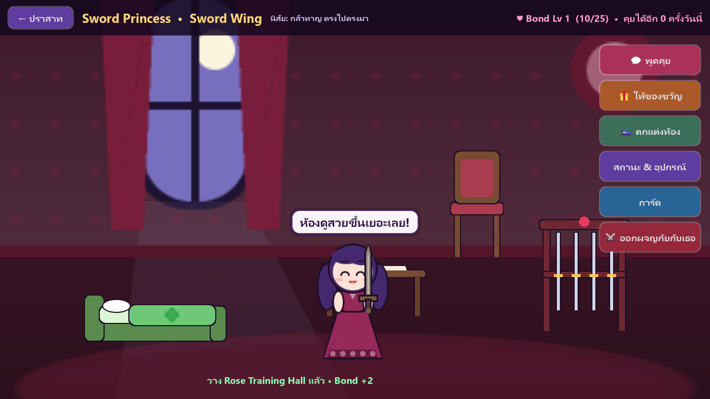
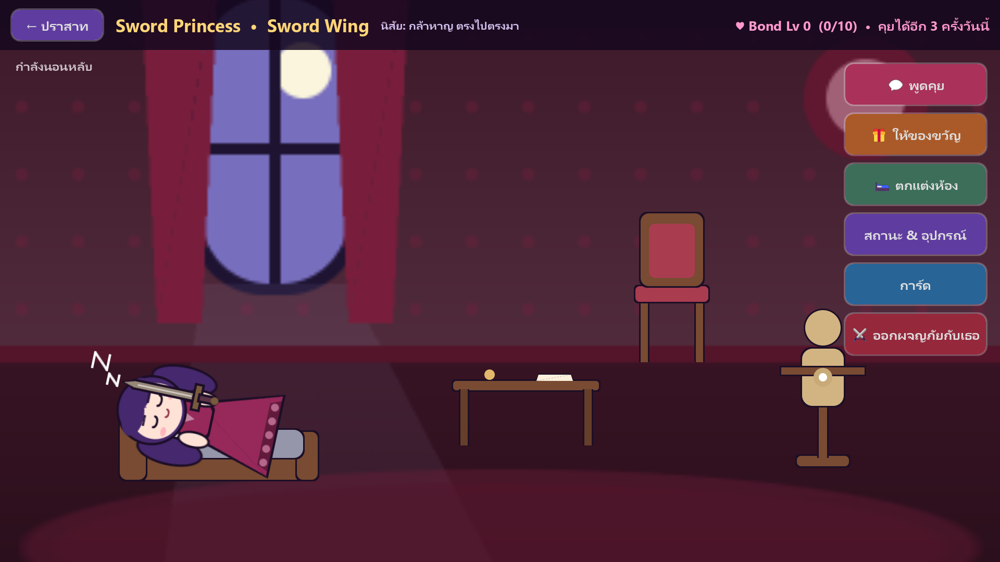
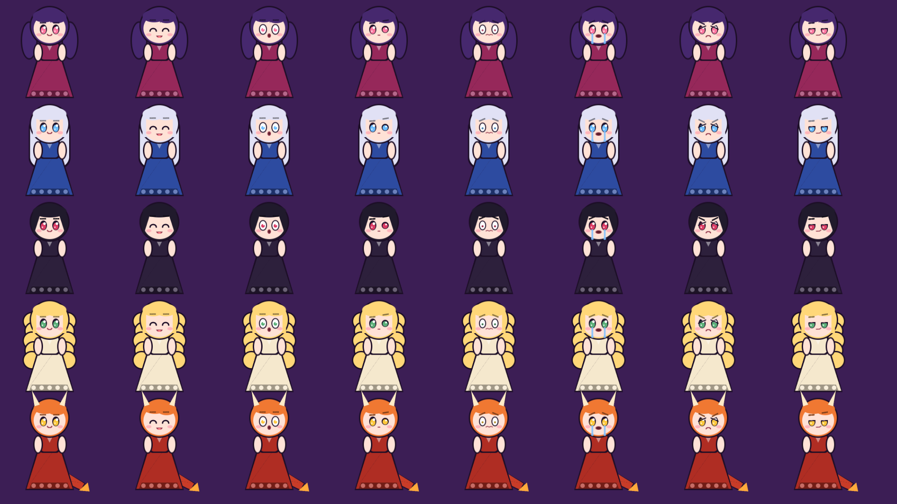
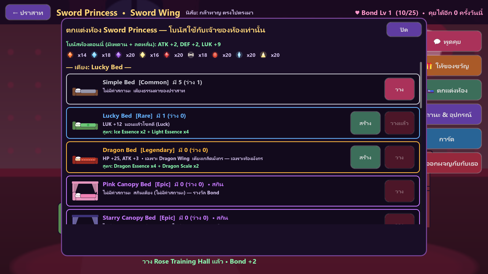
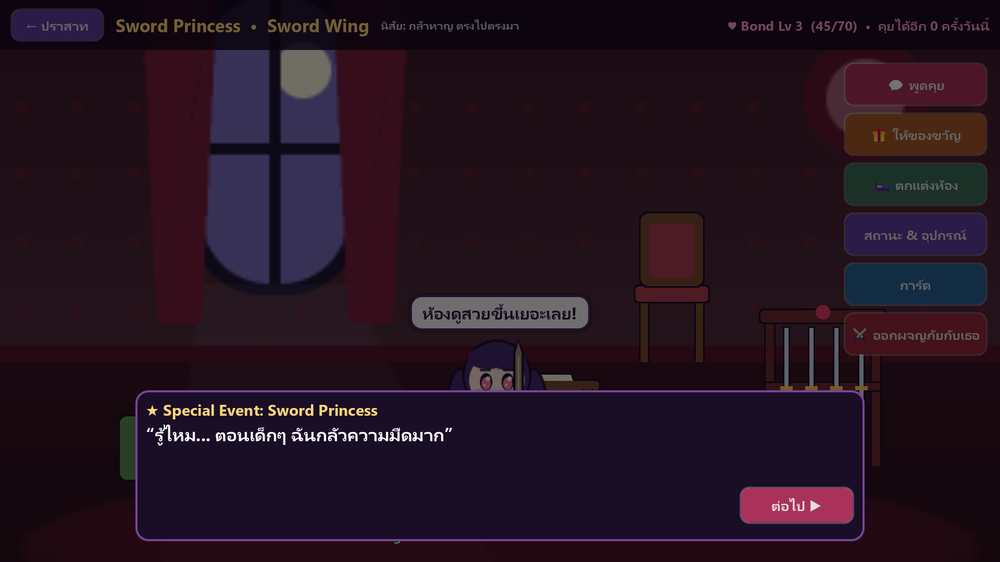

**ความสมดุลของแต่ละเจ้าหญิง** (จำลองรอบแรก 500 รอบ/คน — ทุกคนต้องอยู่ในช่วง 20–90%):
Sword **58%** · Magic **45%** · Shadow **44%** · Light **36%** · Dragon **72%**

---

## Phase 3: Card System

| ระบบ | ทำงานอย่างไร |
|---|---|
| **ใช้การ์ดในการต่อสู้** | แถบการ์ดเหนือปุ่มโจมตี — ใช้ได้ **หลายใบต่อเทิร์นก่อนโจมตี** (ไม่เสียเทิร์น) จ่ายด้วย **มานา** (เริ่ม 1, +1 ทุกเทิร์น, สูงสุด 6) · การ์ดแต่ละใบในเด็คใช้ได้ **1 ครั้งต่อการต่อสู้** |
| **16 การ์ด 4 ประเภท** | ATTACK: Fireball, Fire Blast, Meteor, Dragon Breath · CONTROL: Ice Prison, Shadow Prison, Dimensional Prison, Banish, Sleep, Silence · SUPPORT: Heal, Holy Shield, Lucky Day · SPECIAL: Time Stop, Shadow Execution, Dragon's Wrath |
| **สถานะใหม่** | Freeze (Ice Prison 4 เทิร์น) · **Banish** (ออกจากสนาม แตะ/โจมตีไม่ได้ แล้วกลับมา) · Sleep (ตื่นเมื่อโดนตี) · **Silence** (ใช้ได้แค่ตีธรรมดา — ป้ายบอกท่าเปลี่ยนทันที) · Shield (ดูดซับดาเมจ) · Lucky (+คริ) · Burn (ไฟเผา) · Execute (ประหารเมื่อ HP ≤ 35%) |
| **บอสต้านทาน** | บอส: **ไม่โดน Banish**, Stun/Freeze/Sleep **เหลือครึ่งเดียว** + มีโอกาสต้านตาม `control_resistance` · Execute ใส่บอส = ดาเมจ ×2.5 แทน |
| **Essence & Craft** | มอนสเตอร์ดรอป Fire / Ice / Shadow / Light / Dragon Essence → สร้างการ์ด 13 สูตร เช่น Fire ×3 = Fireball, Ice ×5 = Ice Prison, Dragon ×5 + Fire ×5 = Dragon Breath |
| **Fusion** | Fireball ×3 = **Fire Blast** · Ice Prison + Shadow Prison = **Dimensional Prison** · Dragon Breath ×2 = **Dragon's Wrath** (การ์ดที่ใช้รวมจะหายไป) |
| **Collection & Deck** | การ์ดเก็บถาวร (นับจำนวนใบ) · เด็ค 5 ใบ · ปุ่ม **การ์ด** บนหน้า VICTORY/DEFEAT → 3 แท็บ: การ์ด & เด็ค / สร้างการ์ด / รวมการ์ด |
| **Reward** | ตัวเลือกที่ 3 หลังชนะ = **การ์ด** (สุ่มตามความหายาก, การ์ดจาก Fusion ไม่ดรอป) · เริ่มเกมได้ Fireball + Heal |
| **บันทึก** | ไฟล์เซฟเวอร์ชัน 2 เก็บการ์ด/เด็ค/Essence · เซฟจาก Phase 2 โหลดได้ (ได้การ์ดเริ่มต้นเพิ่มให้) |

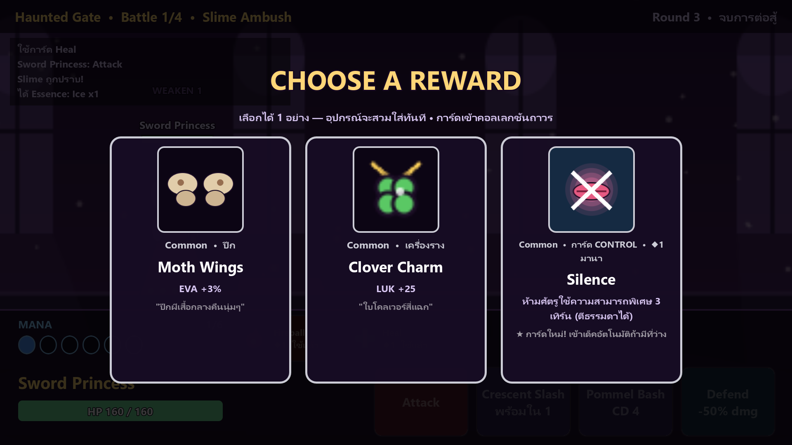
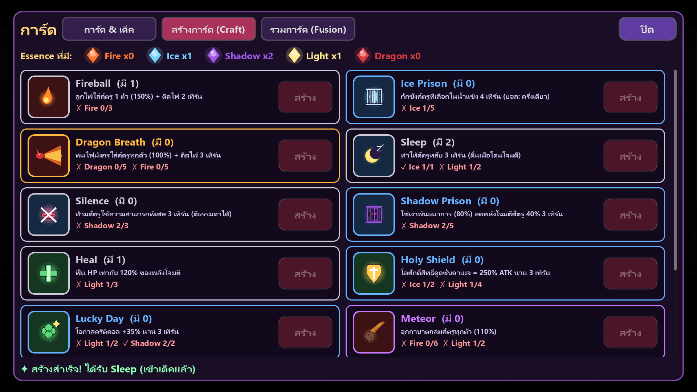
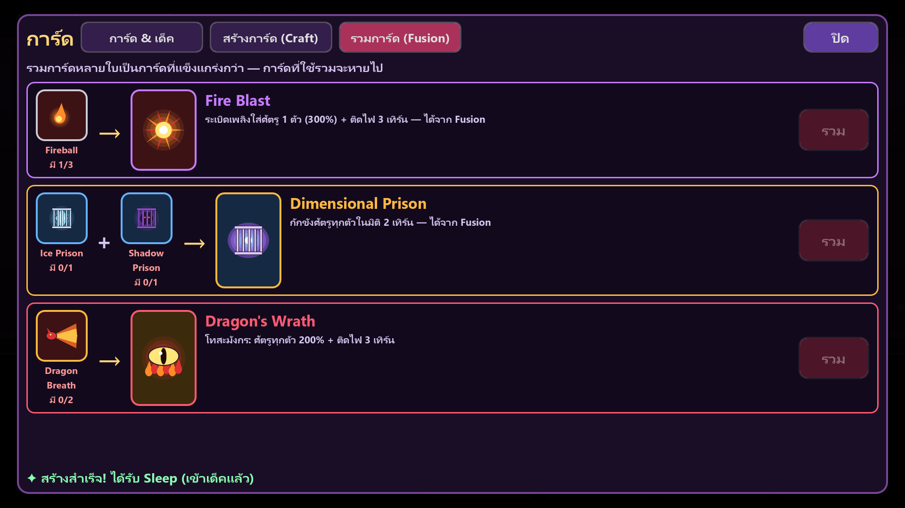

**ความยากหลังมีการ์ด** — การ์ดทำให้เจ้าหญิงเก่งขึ้นมาก (ทดลองแล้วผ่าน 99%) จึงเพิ่มพลังมอนสเตอร์ในด่านเป็น
`monster_hp_scale = 1.3`, `monster_attack_scale = 1.3` (ตั้งใน `data/stage_01.tres` — ใช้เป็นตัวปรับความยากของแต่ละด่านใน Phase 5)

| จำลอง 2,000 รอบ | ผลลัพธ์ |
|---|---|
| รอบแรก ใช้การ์ด + สกิล + Defend อย่างฉลาด | ผ่าน **~57%** |
| รอบแรก กด Attack อย่างเดียว | ผ่าน **~0%** → การ์ดและการวางแผนสำคัญจริง |
| สะสมของ/การ์ดข้ามรอบ | ผ่านภายในครั้งที่ 2: **88%** · ครั้งที่ 3: **97%** · ครั้งที่ 4: **100%** |

---

## Phase 2: Loot & Equipment (ใหม่)

| ระบบ | ทำงานอย่างไร |
|---|---|
| **Choose a Reward** | ชนะทุก Battle → สุ่ม 3 ตัวเลือก: **อุปกรณ์ / อุปกรณ์ / ฟื้น HP 35%** เลือกได้ 1 (ช่องที่ 3 จะเป็น "การ์ด" ใน Phase 3) · Battle สุดท้ายให้อุปกรณ์ 3 ชิ้นแทน |
| **คุณภาพ Loot** | ปกติ: Common 60 / Rare 30 / Epic 9 / Legendary 1 · หลัง **Mini Boss**: 15/45/30/9/1 (มี Mythic) · Boss: 0/25/45/24/6 — แก้ได้ใน `data/loot_table.tres` |
| **5 ช่องอุปกรณ์** | อาวุธ · เครื่องประดับศีรษะ · ปีก · ชุดเกราะ · เครื่องราง — 24 ชิ้น 5 ระดับความหายาก |
| **Paper Doll** | ของที่สวมใส่ **ขึ้นบนตัวเจ้าหญิงทันที** ทั้งในฉากต่อสู้และหน้าอุปกรณ์ (ปีกอยู่หลังตัว อาวุธอยู่ในมือ) |
| **Special Effect** | ดูดเลือด (Abyss Scythe, Vampire Locket) · สะท้อนดาเมจ (Thorn Plate, Mirror of Thorns) · คริแรงขึ้น (Moonlight Blade, Dragon Sword) · ตีติดพิษ (Witch Hat) |
| **หน้าอุปกรณ์ & สถานะ** | ปุ่ม **อุปกรณ์** บนหน้า VICTORY/DEFEAT → ดูตัวละคร, ค่าสถานะรวม (+ส่วนที่ได้จากอุปกรณ์), ช่องสวมใส่, กระเป๋า, เทียบค่ากับของเดิม, สวมใส่/ถอด |
| **บันทึกอัตโนมัติ** | กระเป๋าและของที่สวมใส่ถูกเก็บถาวร (JSON) — แพ้แล้วลองใหม่ ของยังอยู่ = เก่งขึ้นเรื่อยๆ |

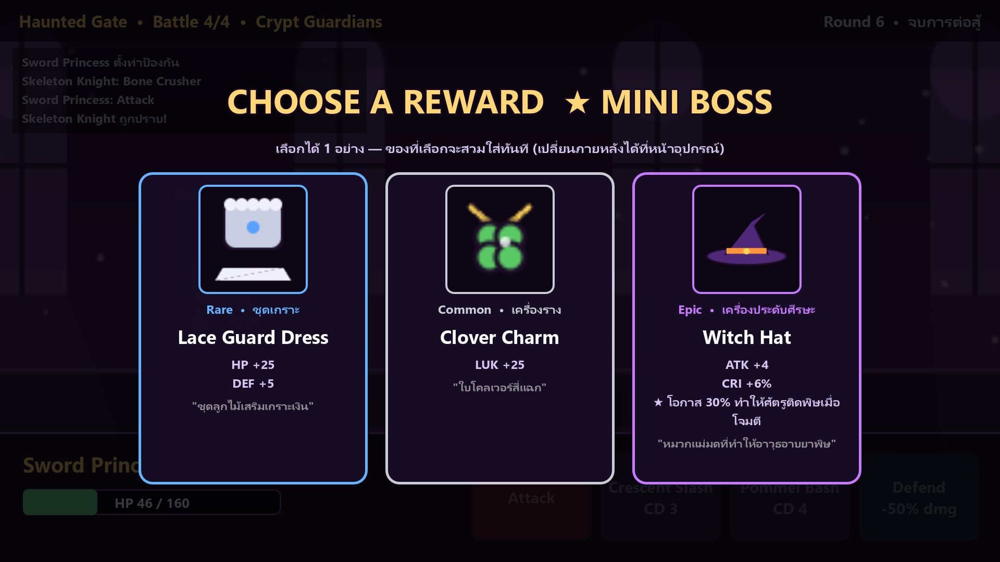
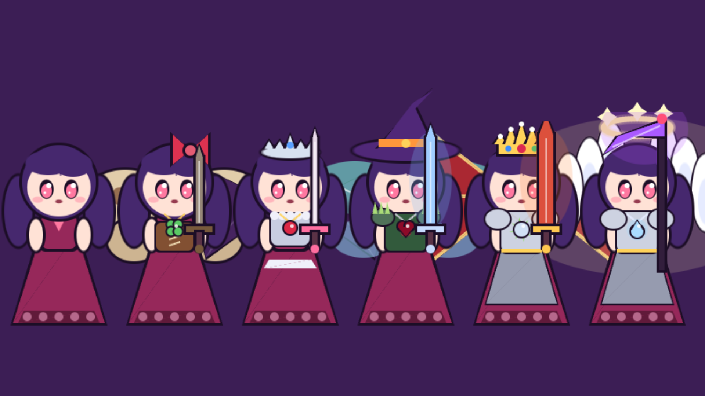

**ความยากหลังมี Loot** (จำลอง 2,000 รอบ, ตัวเลขจาก `tests/run_tests.gd`):
| | ผลลัพธ์ |
|---|---|
| รอบแรก เล่นฉลาด | ผ่าน **~50%** |
| รอบแรก กด Attack อย่างเดียว | ผ่าน **~8%** |
| เก็บของสะสมข้ามรอบ | ผ่านภายในครั้งที่ 2: **76%** · ครั้งที่ 3: **88%** · ครั้งที่ 5: **99%** |

→ ยากตั้งแต่แรก แต่เห็นความก้าวหน้าชัดเมื่อได้อุปกรณ์

**ไฟล์บันทึก**: `%APPDATA%\Godot\app_userdata\Princess Castle\princess_castle_save.json`
(ลบไฟล์นี้เพื่อเริ่มใหม่ · เขียนผ่านไฟล์ชั่วคราวก่อนเพื่อกันไฟล์เสีย · ไฟล์เสียจะถูกสำรองเป็น `.bak` แล้วเริ่มใหม่)

---

## 1. วิธีเปิดเล่น (ไม่ต้องตั้งค่าอะไร)

1. เปิด `Godot_v4.6.2-stable_win64.exe` (อยู่ในโฟลเดอร์ Downloads)
2. หน้า Project Manager → **Import** → เลือกไฟล์ `PrincessCastleGodot/project.godot` → **Import & Edit**
3. กด **F5** (หรือปุ่ม ▶ มุมขวาบน) — เกมเริ่มที่ฉากต่อสู้ทันที

### วิธีเล่น
| การกระทำ | ผล |
|---|---|
| แตะ/คลิกมอนสเตอร์ | เลือกเป้าหมาย (วงแหวนสีทองใต้ตัว) |
| **Attack** | ตีเป้าหมาย 100% ATK |
| **Crescent Slash** | ตีมอนสเตอร์ทุกตัว 75% · คูลดาวน์ 3 เทิร์น |
| **Pommel Bash** | ตี 60% + **Stun** 1 เทิร์น · คูลดาวน์ 4 · บอสต้านได้ 50% |
| **Defend** | รับดาเมจ −50% จนถึงเทิร์นหน้า + ฟื้น 5% HP |

**ข้อความสีส้ม/แดงเหนือหัวมอนสเตอร์ = สิ่งที่มันจะทำเทิร์นหน้า**
`HEAVY 52!` (สีแดง) = ตีหนัก → ควร Defend · `HEAL` = Shaman จะฮีลเพื่อน → ฆ่าก่อน · `POISON` = จะติดพิษ

### ด่าน "Haunted Gate" (4 Battle, HP ต่อเนื่อง + ฟื้น 40% หลังชนะแต่ละครั้ง)
| # | มอนสเตอร์ | กลไก |
|---|---|---|
| 1 | Slime ×2 | Sticky Goo ลด ATK |
| 2 | Slime + Night Bat ×2 | ค้างคาวหลบ 30%, กัด 2 ครั้ง |
| 3 | Goblin ×2 + Bat | พิษ 3 เทิร์น |
| 4 | **[BOSS] Skeleton Knight** + Dark Shaman + Goblin | ท่าหนักแบบเตือนล่วงหน้า, ฮีลเลอร์, ต้าน Stun |

ความยากมาจาก **จำนวน + ความสามารถ + รูปแบบโจมตี** ไม่ใช่แค่ HP

---

## 2. Architecture

```
 data/*.tres (Resources)                       scripts/combat  (pure logic, ไม่มี Node)
 PrincessDefinition ─┐                        ┌─────────────────────────────────────────────┐
 MonsterDefinition  ─┼─► UnitFactory ────────►│ CombatUnit ─► BattleEngine ─► BattleEvent[]   │
 EquipmentDefinition ┘   (base + gear stats    │  DamageCalculator · EnemyBrain · Status       │
 LootTable ───┐           + special effects)   │  on-hit: Lifesteal · Thorns · Poison edge     │
 Stage/Encounter (reward_tier)                 └─────────────────────────────────────────────┘
              │                                         ▲ PlayerCommand        │ events
              ▼                                         │                      ▼
   GameState (autoload) ─ Collection ◄──── BattleController ── replays events as animation
   JSON save in user://     owned / equipped     │        │          │
                                              hud.tscn  unit_view  RewardScreen / EquipmentScreen
                                                        (PaperDoll layers)
```
- **BattleEngine ไม่ใช้ Node เลย** จึงทดสอบ/จำลองได้หลายพันรอบแบบ headless
- Engine คืนค่าเป็น **รายการเหตุการณ์** → ฉากแค่นำมาเล่นเป็น animation (กฎกับภาพแยกกันชัดเจน)
- **ข้อมูลทั้งหมดเป็น Resource (.tres)** → เพิ่มเจ้าหญิง/มอนสเตอร์/อุปกรณ์/ด่านได้โดยไม่แก้โค้ดหลัก
- `UnitFactory` คือจุดเดียวที่รวมโบนัส (base + อุปกรณ์ → อนาคต: เฟอร์นิเจอร์, Companion, Bond)
- `Collection` (owned/equipped) เป็น logic ล้วน ทดสอบได้ · `GameState` (autoload) ห่อไว้และบันทึกไฟล์
- `PaperDoll` วางแต่ละชิ้นตาม `slot_anchors` ของเจ้าหญิง → เจ้าหญิงคนใหม่แค่กำหนดจุดยึดของตัวเอง
- Animation ใช้ **Tween ของ Godot** (เทียบเท่า DOTween) ใน `CharacterAnimator` — ใช้ซ้ำได้ทุกตัวละคร

## 3. โครงสร้างไฟล์

```
PrincessCastleGodot/
├── project.godot                 1920x1080, landscape, Compatibility renderer, autoload GameState
├── assets/art/                   placeholder: princess_base.png (ไม่มีอุปกรณ์), มอนสเตอร์, bg
├── assets/art/items/*.png        24 layer ของอุปกรณ์ (วางตรงจุดยึดบนตัว = ใช้เป็นไอคอนด้วย)
├── assets/fonts/ui_font.tres     SystemFont → ฟอนต์ไทยของเครื่อง (Leelawadee UI / Noto Sans Thai บน Android)
├── scripts/combat/               กฎการต่อสู้: combat_unit, battle_engine, damage_calculator, enemy_brain,
│                                 ability_spec, stat_block, battle_event, auto_battle_policy, ...
├── scripts/items/                ★ Phase 2
│   ├── item_types.gd             enum Slot / Rarity / Special / Tier + ชื่อ สี คำอธิบาย
│   ├── equipment_definition.gd   ไอเท็ม: stats, special effect, texture, layer_offset
│   ├── item_stats.gd             รวม/เทียบ/อธิบาย stats, คะแนนพลังไอเท็ม
│   ├── loot_table.gd             สุ่ม Reward ตาม rarity weights ของแต่ละ tier
│   └── collection.gd             ของที่มี + ของที่สวมใส่ + รูปแบบไฟล์บันทึก
├── scripts/cards/                ★ Phase 3: card_types, card_definition, essence_drop, craft_recipe, fusion_recipe, card_library
├── scripts/castle/               ★ Phase 4: castle_types, castle_progress (bond/ห้อง/ปลดล็อก), furniture_definition, furniture_rules,
│                                 dialogue_line, dialogue_db, princess_roster, living_princess, speech_bubble, castle_controller
├── scripts/core/game_state.gd    autoload: โหลด/บันทึก JSON (เวอร์ชัน 3, ไฟล์ชั่วคราว, .bak) + เจ้าหญิงที่เลือก
├── scripts/data/                 Princess/Monster/Encounter/StageDefinition, UnitFactory
├── scripts/battle/               battle_controller, battle_hud, unit_view, ★paper_doll, character_animator, ...
├── scripts/ui/                   ui_kit, reward_screen, equipment_screen, ★ cards_screen (เด็ค/Craft/Fusion)
├── scenes/                       ★ castle.tscn (ฉากเริ่ม), battle.tscn, hud.tscn, unit_view.tscn
├── data/                         princess_sword, monsters/*, encounters/*, stage_01, balance_config,
│                                 loot_table.tres, items/*.tres (24 ชิ้น), ★ card_library.tres, ★ cards/*.tres (16 ใบ)
├── tests/run_tests.gd            76 unit tests (combat + items + cards + castle) + จำลองด่าน + จำลองเจ้าหญิงทั้ง 5 · จับ script error ได้
├── tests/castle_autoplay.gd      ทดสอบปราสาทผ่านปุ่มจริง: ห้อง, กิจกรรม, คุย (จำกัด/วัน), ของขวัญ, สร้าง+วางเฟอร์นิเจอร์, Story, รางวัล Bond, ออกผจญภัย
├── tests/autoplay.gd             เล่นฉากจริง: กดปุ่ม HUD + การ์ด, เลือก Reward, หน้าอุปกรณ์, หน้าการ์ด (เด็ค/Craft) + ถ่ายภาพ
└── tools/                        generate_data.gd (+castle_data.gd), generate_art.gd (+castle_art.gd), preview_doll/cards/faces.gd
```

---

## 4. ปรับสมดุล / เพิ่มคอนเทนต์ (ไม่ต้องแก้โค้ด)
- ดับเบิลคลิกไฟล์ใน `data/` → แก้ใน Inspector
- **อุปกรณ์ใหม่**: New Resource → `EquipmentDefinition` → ใส่ stats, special, texture (วาดให้ตรงจุดยึดของช่องนั้น)
  แล้วลากเข้า `data/loot_table.tres > items` · ปรับตำแหน่งละเอียดด้วย `layer_offset`
- **อัตรา Drop**: `data/loot_table.tres` → `normal_weights`, `mini_boss_weights`, `boss_weights`
- **ตัวเลือก Reward**: `option_kinds` (เช่น `equipment, equipment, restore`) · `restore_fraction`
- **ของเริ่มต้น / จุดยึด Paper Doll**: `data/princess_sword.tres` → `starting_equipment`, `slot_anchors`
- **มอนสเตอร์ / Encounter / Boss**: เหมือน Phase 1 · ตั้ง `reward_tier` ของ Encounter (NORMAL / MINI_BOSS / BOSS)
- `tools/generate_data.gd` และ `tools/generate_art.gd` จะ **เขียนทับ** — ใช้เมื่ออยากรีเซ็ตเท่านั้น

---

## 5. การทดสอบ (ทดสอบแล้วจริงบนเครื่องนี้)
```bash
GODOT="$HOME/Downloads/Godot_v4.6.2-stable_win64.exe/Godot_v4.6.2-stable_win64_console.exe"
"$GODOT" --headless --path . --script res://tests/run_tests.gd
"$GODOT" --headless --path . --script res://tests/autoplay.gd -- --seed=1
"$GODOT" --headless --path . --script res://tests/castle_autoplay.gd
# Phase 5: ด่าน/เลเวล/ผู้ช่วยที่เลือกเอง
"$GODOT" --headless --path . --script res://tests/autoplay.gd -- --seed=4 --stage=stage_02 --level=12 --companion=magic_princess
```
ผลล่าสุด:
- ✅ `run_tests.gd`: **98/98 ผ่าน** — (Phase 6 ใหม่ 9) ค่าตั้ง (กรองค่าผิด, บันทึก/โหลด), เซฟ checksum + สำรอง 2 รุ่น, เซฟถูกแก้/ขาดกลางคัน → โหลดสำรอง, เซฟเก่า v4, เริ่มเกมใหม่, เซฟครบทุกช่องตามสเปก, SoundBank ครบ, Safe Area, Export preset · (ใหม่ 13) เฟสบอส: คลั่ง/เรียกลูกน้อง/ทำงานครั้งเดียว/ล้าง+โล่+ฟื้น/จำกัดจำนวน, บอสจริงต้านควบคุม, ผู้ช่วยช่วยทุก N รอบ + ไม่ถูกเล็ง + ฮีลเจ้าหญิง, Synergy ดาเมจ/ฟื้นฟู + ครบ 10 คู่, เลเวล/EXP/เพดาน, ปลดล็อกตามด่าน + ลำดับด่าน, เซฟ v4 + ย้ายเซฟเก่า, ข้อมูลด่านจริง · จำลองแคมเปญ 4 ด่าน · Bond/คุย/ของขวัญ/รางวัล, เฟอร์นิเจอร์ (เพดาน, ลดหลั่น, สกิน, เฉพาะเจ้าของ, เฉพาะปีก), ปลดล็อก, เลือกบทพูด, เซฟ v3, ข้อมูลเจ้าหญิง 5 คน + ไฟล์สีหน้าครบ · การ์ด/มานา, Freeze/Banish/Sleep/Silence/Shield/Lucky/Burn/Execute/Time Stop, บอสต้าน, Craft/Fusion/เด็ค, เซฟ v2 + เซฟเก่า · ระบบต่อสู้, stats จากอุปกรณ์, ดูดเลือด/สะท้อน/คริ/พิษ, สุ่ม loot (ไม่ซ้ำ, ตามน้ำหนัก, Mythic เฉพาะบอส), สวม/ถอด, บันทึกไฟล์จริง + ไฟล์เสีย, ตรวจ data จริง + จำลองด่าน
- ✅ `castle_autoplay.gd` (Phase 6): ⚙ → เปลี่ยนความเร็ว 2x / 30 FPS (ใช้จริงกับ Engine) / เพลง 40% / การสั่น → ปุ่ม Back ปิดหน้าตั้งค่า · มีเสียงคลิก + เพลงปราสาท
- ✅ `autoplay.gd` (Phase 6): ตรวจว่าเสียง ตี/ตาย/การ์ด/ชนะ ดังจริงระหว่างเล่น, เพลงบอสในด่านบอส
- ✅ `perf_probe.gd`: ทุกฉาก ~1 ms/เฟรม (`docs/perf_phase6.txt`) · ✅ Export APK + `apksigner verify` + `aapt dump badging` ผ่าน
- ✅ `castle_autoplay.gd`: ผ่านทุกขั้น → เลือก Light เป็นผู้ช่วยผ่านปุ่มจริง → ห้อง Magic → หน้าเลือกด่าน → Frozen Library: ผู้ช่วยอยู่ในฉาก, Synergy Starlit Prayer, มานาเริ่ม 3
- ✅ `autoplay.gd --stage=stage_02 --level=12 --companion=magic_princess`: **ผ่านด่านผ่านปุ่มจริง** — Frost Golem เข้าเฟส, Lich Queen เรียก Ice Wisp 2 ตัว (มีภาพในฉาก) + คลั่ง, ผู้ช่วยช่วย 6 รอบ, ได้ EXP · stage_03 ถึงบอส Night Witch (เฟส + เรียก Imp) · stage_04 ด้วยอุปกรณ์เริ่มต้นแพ้ในการต่อสู้ที่ 2 (ตั้งใจ: ด่านสุดท้ายต้องมีอุปกรณ์/การ์ดสะสม)
- ✅ `autoplay.gd`: เล่นฉากจริงจนจบหลาย seed — เลือก Reward ผ่านการ์ดจริง, ตรวจว่า **Paper Doll แสดงครบทุกชิ้น**, เปิดหน้าอุปกรณ์แล้วถอด/ใส่ผ่านปุ่มจริง — ไม่มี error · autoplay **ไม่แตะไฟล์บันทึกของผู้เล่น**
- ✅ ถ่ายภาพหน้าจอจริงตรวจ UI/ภาษาไทย (`docs/screenshots/`)
- ⚠️ ยังไม่ได้ทดสอบบนมือถือ Android จริง (ดูข้อ 6)

---

## 6. Export เป็น Android APK (ตั้งค่าบนเครื่องนี้แล้ว)
เครื่องมือติดตั้งแล้ว (ในโฟลเดอร์ผู้ใช้ ไม่แตะระบบ): JDK 17 → `~/AndroidTools/jdk`, Android SDK (platform 35, build-tools 35.0.1, platform-tools) → `~/AndroidTools/sdk`, Export Templates 4.6.2 (เฉพาะ Android) → `%APPDATA%/Godot/export_templates/4.6.2.stable`, debug keystore → `~/AndroidTools/debug.keystore` · Editor Settings ชี้ path ให้แล้ว (สำรองไฟล์เดิมไว้ที่ `editor_settings-4.6.tres.before-android.bak`)

สร้าง APK ใหม่:
```bash
"$GODOT" --headless --path . --export-debug "Android" build/PrincessCastle-debug.apk
```
ติดตั้งลงมือถือ: เปิด **Developer options → USB debugging** บนมือถือ, เสียบสาย แล้ว
```bash
~/AndroidTools/sdk/platform-tools/adb.exe install -r build/PrincessCastle-debug.apk
```
(หรือคัดลอกไฟล์ `.apk` ไปมือถือแล้วเปิดติดตั้ง — ต้องอนุญาต "ติดตั้งจากแหล่งที่ไม่รู้จัก")

**Release สำหรับ Google Play:** สร้าง keystore ของคุณเอง (`keytool -genkeypair ... -keystore release.keystore`) → Project → Export → Android → Keystore/Release ใส่ path + รหัสผ่าน → `--export-release`; ถ้าจะส่ง Play Store ให้เลือก Export Format **AAB** (ต้องเปิด Gradle build). ปุ่ม `[ทดสอบ] ปลดล็อกทั้งหมด` จะหายไปเองใน release build

## 6b. เล่นบน Windows
- **ง่ายสุด:** ดับเบิลคลิก `build/windows/PrincessCastle.exe` (ไฟล์เดียว 107 MB, ไม่ต้องติดตั้ง, เป็น release จึงไม่มีปุ่มทดสอบ)
- **ปุ่ม:** เมาส์ = แตะ · **Esc** = ปุ่ม Back · **F11** หรือ **Alt+Enter** = เต็มจอ/หน้าต่าง
- **เซฟอยู่ที่:** `%APPDATA%\Godot\app_userdata\Princess Castle\` (ใช้ร่วมกับตอนรันจาก Godot Editor)
- สร้าง .exe ใหม่หลังแก้เกม:
```bash
"$GODOT" --headless --path . --export-release "Windows" build/windows/PrincessCastle.exe
```

## 6c. เล่นผ่านเว็บ
- **เล่นเลย:** https://phuketradar-cloud.github.io/princess-castle/ (คอมและเบราว์เซอร์มือถือ, ไม่ต้องติดตั้ง, โหลดครั้งแรก ~10 MB)
- เซฟเก็บในเบราว์เซอร์ (IndexedDB) แยกจากเวอร์ชัน Windows/Android · ล้างข้อมูลเว็บไซต์ = เซฟหาย
- เป็น build แบบไม่ใช้เธรด (ทำงานบน GitHub Pages ได้โดยไม่ต้องตั้ง header พิเศษ)
- ทดสอบในเครื่อง: `"$GODOT" --headless --path . --export-release "Web" build/web/index.html` แล้ว `node tools/serve_web.js` → http://localhost:8060
- อัปเดตเว็บ: export ใหม่ แล้ว push โฟลเดอร์ `build/web` ไปที่ branch `gh-pages`

**ฟอนต์:** ใช้ **Prompt** (Cadson Demak) และ **Noto Sans Symbols 2** (Noto Project) — SIL Open Font License 1.1 (`assets/fonts/OFL-*.txt`) — ฝังในเกม ภาษาไทยจึงแสดงเหมือนกันทุกแพลตฟอร์ม (`tests/test_release.gd` ตรวจว่าทุกตัวอักษรในเกมมีในฟอนต์)

## 7. ข้อจำกัด / Phase ถัดไป
- ภาพเป็น placeholder ที่วาดด้วยโค้ด · ปีกบางแบบถูกผมเปียบังไปบางส่วน (ปรับได้ด้วย `layer_offset` หรือภาพจริง)
- ปฏิกิริยาเจ้าหญิงต่ออุปกรณ์ ("ดาบเล่มนี้หนักจัง...") อยู่ใน Phase 4 (Dialogue + สีหน้า) — ข้อความเตรียมไว้ใน description แล้ว
- **ยังไม่ได้ทดสอบบนมือถือ Android จริง** — APK สร้าง/เซ็น/ตรวจสอบแล้ว แต่ต้องลองติดตั้งเพื่อตรวจ touch, safe area, ปุ่ม Back, เสียง, ความเร็วบนเครื่องจริง
- เสียง/เพลงเป็น placeholder สังเคราะห์ด้วยโค้ด (เปลี่ยนใน `data/sound_bank.tres`)
- แถบวัตถุดิบด้านบนของปราสาทล้นขอบขวาเล็กน้อยเมื่อมีครบ 9 ชนิด
- ข้อความสถานะเหนือหัวเจ้าหญิง (เช่น POISON/WEAKEN) บางครั้งซ้อนกับกล่อง log มุมซ้ายบน — ใช้งานได้แต่ควรจัดตำแหน่งใหม่
- เซฟจาก Phase 4 ที่ปลดล็อก Shadow/Light/Dragon ด้วยจำนวนครั้ง จะกลับเป็นล็อกจนผ่านด่านที่กำหนด (กติกาใหม่)
- ภาพทั้งหมดยังเป็น placeholder วาดด้วยโค้ด (ท่าทางในห้องใช้การหมุน/ย่อ + ของประกอบ แทนภาพท่าแยก — ใส่ภาพท่าจริงได้ภายหลัง)
